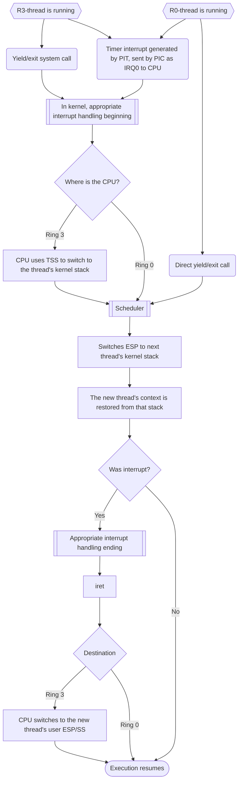

# Rudimentary x86-32 OS
An operating system built to serve as a showcase of simplified orthodox design. It has been tested on an i586 processor emulated via Bochs 2.8.

For details not concerning the architecture, see the code itself, which is annotated.

The OS has the following features:

| Name                        | Implemented? | Description |
| --------------------------- | - | --- |
| BIOS-booting                | Y | Given x86 typically uses BIOS, this is only natural. |
| Preemptive Scheduling       | Y | It is interrupt-driven. Context switches are done with Round Robin for simplicity. |
| Multitasking                | Y | Multiple threads and programs residing in memory at once. |
| Paging                      | Y | Two-level virtual address spaces. Per-process page directories, physical frame allocator, page fault handler. |
| Demand-paging / Swapping    | - | Page eviction to disk is not implemented. |
| Simplified UNIX File System | - | Including inodes. |
| Privilege Levels            | Y | . |
| Permissions                 | . | . |
| System Call Interface       | Y | We have system calls. |
| Traditional Synchronization | Y | We have all the usual synchronization primitives. |
| Shared buffers              | . | . |
| Mailboxes                   | Y | . |
| PS/2 Keyboard Driver        | . | very simple |
| ATA PIO Disk Driver         | Y | very simple |
| CLI-interface               | - | . |

And the following attributes:

| Name | Description |
| --- | --- |
| x86-based             | Supports x86 processors only. Note x86 is little endian. |
| General-purpose       | As opposed to something fringe like a fridge. |
| Orthodox              | It is not bold and unique, it follows the mold of UNIX. Still, some breaks with the orthodoxy are observed. Breaks are stated in the design document. |
| Uniprocessor          | That only one task is running at a time. It does not utilize multiple cores. |
| Monolithic            | OS services and resources are in the kernel space. |
| Static Device Drivers | All device drivers are hard-coded into the OS. |
| Process Isolation     | Processes are meant to not disrupt each other arbitrarily. |
| Indefinite Runtime    | The OS is supposed to be able to run forever without needing to reboot. Likewise, it is not supposed to degrade theoretically in any way despite having run for a long time. |
| Freestanding          | Not reliant on standard library and stuff. |

# 1 How to use
In terms of physical hardware, it is today only legacy machines that are capable of running this, which you are unlikely to have lying around. So we heavily recommend emulating the hardware instead.

## 1.1 Hardware Requirements
- The CPU needs to be x86 32-bit. Some legacy variants are not supported, (but we have yet to determine which and plan to support them at a later time). Only one core is used.
- The Disk needs to have an ATA interface. Many modern disks lack it, so you probably need an emulation layer.
- USB keyboards are not yet supported.
- Disk space enough to fit the disk image. And it does not expand to fit additional space in its partition.
- At least (TBD) of RAM.
- Preferably BIOS boot firmware.
- VGA-compatible graphics.
- 8259 PIC.

## 1.2 Compilation
We have provided a makefile that on `make boot` creates a disk image.
- Compilation tested to work both on Linux and Macintosh.
- It compiles using GCC.

## 1.3 From Emulator
Use the compiled image.

We have provided a bochsrc configuration. To use it, it needs to be placed wherever bochs looks for it.

## 1.4 From USB
There is no installer to this OS, and it is very difficult to manually transplant an OS into a machine, so we only detail the much simpler booting from a USB device. This however, has the adverse effect of all disk actions having to inefficiently pass through the USB device.

The the image has to be "burned" onto the USB to ensure the image is aligned correctly.

You select the USB as the device to boot from in your machine's bootloader.

# 2 Design Overview
| Section |
| --- |
| [3 Startup](#3-startup) |
| [4 Execution Management](#4-execution-management) |
| [5 Volatile Memory Management](#5-volatile-memory-management) |
| [6 Interprocess Communication](#6-interprocess-communication) |
| [7 File System](#7-file-system) |
| [8 Keyboard Driver](#8-keyboard-driver) |
| [9 Screen Driver](#9-screen-driver) |
| [10 Disk Driver](#10-disk-driver) |
| [11 Serial Driver](#11-serial-driver) |
| [12 Libraries](#12-libraries) |
| [13 Sources](#13-sources) |

## 2.1 Folder Structure
```text
boot/
└── bootblock.s

kernel/
├── kernel.cpp/hpp
├── kernel.ld
├── entry.S/hpp
├── faults.S/hpp
├── interrupt.cpp/hpp
├── scheduler.cpp/hpp
├── pic.cpp/hpp
├── synchronization.cpp/hpp
├── memory.cpp/hpp
├── paging.cpp/hpp
├── mailbox.cpp/hpp
├── fs/
│   ├── fs.cpp/hpp
│   ├── block.cpp/hpp
│   └── inode.cpp/hpp
├── kdaemons/
│   ├── loader.cpp/hpp
│   └── clock.cpp/hpp
└── drivers/
    ├── keyboard.cpp/hpp
    ├── disk.cpp/hpp
    ├── serial.cpp/hpp
    └── screen.cpp/hpp

lib/
├── minstd/
│   ├── string.cpp/hpp
│   ├── types.cpp/hpp
│   └── utils.cpp/hpp
├── syslib.cpp/hpp
├── utils.cpp/hpp
├── time.cpp/hpp
├── sleep.cpp/hpp
└── print.cpp/hpp

tools/
└── createimage.c/h

user/
├── programs/
│   ├── shell.c/h
│   └── etc.
└── include/
    └── headers/
        └── etc.
```

## 2.2 Disk Layout
(NB: Items are placed in order.)

| Sectors           | Description        |
|-------------------|--------------------|
| 1                 | Bootblock          |
| `KERNEL_SECTORS`    | Kernel             |
| 1                 | Superblock         |
| `INODE_SECTORS`     | Inodes             |
| 1                 | Allocation Bitmaps |
| `DATABLOCK_SECTORS` | Data Blocks        |
| 1                 | Program Directory  |
| 1                 | Shell              |
| Many              | Programs           |

useless? move to file system talk? programs should be part of the file system

# 3 Startup
When a CPU using x86 architecture first loads up, it enters its reset state, which is in Real Mode (16bit) with interrupts disabled. It then reads and runs the physical address 0xFFFF0 where the BIOS firmware is. The BIOS then selects a bootable device to jump to.

## 3.1 Image Creation
Both the BIOS and kernel expect the contents of the OS to be structured in a certain way. In mind of that, we make for easy insertion into the booting device the OS shall reside in a disk image, which is an ordered sequence of uncompressed binaries. It is called an "image" because it is an exact image of what the booting device should look like.

Note since image creation is not in an embedded context, we are able to access C/C++ standard libraries.

Since the kernel needs to be loaded into memory during boot, it is important it knows the size of the kernel. This could be done during boot, but we do it at image creation. It is done by counting how many sectors the kernel is, and then writing it into somewhere the bootloader checks.

See [2.2 Disk Layout](##2.2-disk-layout) for the exact layout of the image. 

### 3.1.1 ELF-handling
Since files are expected to be compiled in the ELF format, and so contain ELF Headers. With how rudimentary this OS is, this information is scarcely utilized during runtime. And so it is stripped during image creation and potentially relevant information in it is gleaned and written down elsewhere. This both simplifies finding that information and reduces image size.

ELF File Header:

| Field         | Description                                                                         |
| ------------- | ----------------------------------------------------------------------------------- |
| `e_ident`     | Identification bytes: ELF magic number, class (32/64-bit), endianness, ABI, version. |
| `e_type`      | Object file type (relocatable, executable, shared library, core dump, etc.).         |
| `e_machine`   | Target CPU architecture (e.g., x86, x86-64, ARM, RISC-V).                            |
| `e_version`   | ELF format version.                                                                  |
| `e_entry`     | Virtual address of the program entry point.                                          |
| `e_phoff`     | File offset to the Program Header Table.                                             |
| `e_shoff`     | File offset to the Section Header Table.                                             |
| `e_flags`     | Architecture-specific flags.                                                         |
| `e_ehsize`    | Size of the ELF header itself.                                                       |
| `e_phentsize` | Size of one Program Header entry.                                                    |
| `e_phnum`     | Number of Program Header entries.                                                    |
| `e_shentsize` | Size of one Section Header entry.                                                    |
| `e_shnum`     | Number of Section Header entries.                                                    |
| `e_shstrndx`  | Index of the section containing section names.                                       |

Remarks:
- There can be an arbitrary number of Program Headers as described by `e_phnum`.
- A check needs to be applied on `e_ident` for 32-bit and `e_machine` for x86 architecture.
- Since we are only using the Execution View, we skip Linking View specific things like Section Headers. Execution View is used when it is loaded in memory.

ELF Program Header: Shows us the structure of the ELF header containing metadata and offset to Program Header as Elf32_Ehdr.e_phoff.

| Field      | Description                                               |
| ---------- | --------------------------------------------------------- |
| `p_type`   | Segment type (`PT_LOAD`, `PT_DYNAMIC`, `PT_INTERP`, etc.). |
| `p_flags`  | Access permissions (read, write, execute).                 |
| `p_offset` | Offset of segment data within the file.                    |
| `p_vaddr`  | Virtual address where segment should be loaded.            |
| `p_paddr`  | Physical address.             |
| `p_filesz` | Number of bytes occupied in the file.                      |
| `p_memsz`  | Number of bytes occupied in memory.                        |
| `p_align`  | Required alignment of the segment.                         |

Remarks:
- `p_offset` gives location from beginning of the file.
- `p_type` gives us the type of the segment, we want to load only the ones of type PT_LOAD.
- `p_addr` the location in memory of the segment in memory.
- `p_memsz` number of bytes that needs.
- `p_filesz` number of bytes occupied, can be zero.

TODO: Some unncessary information is not being stripped.

## 3.2 Bootblock
Our bootloader consists only of the first sector bootblock. The boot sector and first instruction of the bootblock need to be located at 0x07C00 in memory, and occupy precisely 512 bytes (1 sector).

1. realmode stack
2. Set segment registers. DS, CS, SS, ES. Needed to reference self and for the long jump? 
3. Load the next stage (in this case, the kernel). It needs to use interrupt 0x13 for this. Note it takes an 8bit integer for sectors to read, meaning it is only able to load 255 sectors at once. For a kernel of greater size, a loop is required, but has yet to be needed. Now our memory should look approximately like this: 

| Address         | Name          | Description                                                                                                    |
|-----------------|---------------|----------------------------------------------------------------------------------------------------------------|
| 0x07C00         | Bootblock     | Located from the CPU reset entry point. |
| 0x07DFE         | Boot signature | 0x55AA                                                                                                          |
| 0x08000         | Kernel        | Several sectors.                                                               |
| 0x70000-0x7FFFE | Stack         | Top of stack at 0x7FFFE. Grows downward to lower addresses.                                      |

4. Enable the A20 line to allow addressing beyond the first megabyte. The fast A20 method is used without fallback. Some legacy machines do not support this.
5. Switch to Protected Mode (to enter 32-bit). Disable interrupts to avoid jumping to garbage once Protected Mode has been entered, in case hardware still has the old interrupts. Create a GDT (Global Descriptor Table). We need three GDT Entries. The first is the Null Entry with everything zeroed out. The second and third are the Code Entry and Data Entry fo ring 0, since that is the level we start at. They share limit and base since they need to start and access the same places. The location of these are then written into the CPU's GDT register using the LGDT instruction.

GDT Entry:

| Bits  | Field        | Description                                | Value to set | Reason |
| ----- | ------------ | ------------------------------------------ | ------------ | ------ |
| 0-15  | Limit[15:0]  | Lower 16 bits of segment limit (of where kernel can be addressed). | 0xFFFF | No reason kernel should not be able to access everything during startup. Lower part of 4-GB limit. |
| 16-31 | Base[15:0]   | Lower 16 bits of base address.             | 0 | Base address is 0 since image of the disk starts at 0. |
| 32-39 | Base[23:16]  | Middle 8 bits of base address.             | 0 | Base address continued. |
| 40    | Type[0]      | Accessed.                                  | 0 | Managed by the CPU. |
| 41    | Type[1]      | Readable (code) / Writable (data).         | 1 | Needs to be usable. |
| 42    | Type[2]      | Conforming (code) / Expand-down (data).    | 0 | ? |
| 43    | Type[3]      | Executable (code) / Reserved (data).       | 1 (code) / 0 (data) | Only used to indicate it is code. |
| 44    | S            | Descriptor Type.                           | 1 | 0=System, 1=Code/Data |
| 46-45 | DPL          | Descriptor Privilege Level (0–3).          | 0 | Ring 0 (kernel). |
| 47    | P            | Present.                                   | 1 | Always 1. |
| 48-51 | Limit[19:16] | Upper 4 bits of segment limit.             | 0xF | Completes the limit. |
| 52    | AVL          | Available for software use.                | 0 | Unused. |
| 53    | L            | 64-bit code segment.                       | 0 | 0=16/32bit, 1=64bit |
| 54    | D/B          | Default operand size.                      | 1 | 0=16bit, 1=32bit |
| 55    | G            | Granularity.                               | 1 | Multiplier of limit, need to reach 4-GB (0=byte, 1=4KiB). |
| 56-63 | Base[31:24]  | Upper 8 bits of base address.              | 0 | Base address continued. |

6. Set CR0's (Control Register's) bit to enable Protected Mode.

CR0 bits:

| Bit | Name                       | Meaning                                  |
| --- | -------------------------- | ---------------------------------------- |
| 0   | **PE** (Protection Enable) | Enables Protected Mode.                  |
| ... | ...                        | (Irrelevant for our purposes, set to 0.) |
| 31  | **PG** (Paging)            | Enables paging.                          |

7. Long jump to next stage. Not simply a normal jump, because this flushes Real Mode remnants and loads code segment (?). The destination of the jump needs to be the entrypoint of the kernel. The location of which is not reliably controllable in C. This is solved here by writing it down into the ELF-header via the linker script, which is then written into the bootblock during image creation.
8. For the device to be identified as bootable, the first sector needs to end with signature 0x55AA. 

## 3.3 Kernel Initialization
This consists of initializing all the parts of the kernel, each of which is shown later.

# 4 Execution Management
A general-purpose OS is characterized by its ability to run arbitrary user programs. A program is a series of code (instructions) and data. Since you should be able to run multiple programs, and since a program should be able to run multiple tasks, yet the CPU is only able to process one task at a time, a first question is in what order they should be run in. The orthodox answer is to run them in small timeslices in round-robin rotation for various (but no particularly strong) reasons.

One aspect of this that is not arbitrary however, is preemption, the ability to interrupt a task at an arbitrary time. When that is not possible, tasks either run until completion, or yield at times specified in their programs. This is unacceptable for isolation as it may stop the entire OS if programs fail to do so, which is why the scheduled preemption in a typical round-robin rotation is important. And furthermore, a lack is also not compatible with modern hardware, where most devices use arbitrary interruptions regularly, something execution is expected to be able to recover from.

When yielding at specific times or only on completion, it is possible no context needs to be saved between each resumption, and when context needs to be saved, it could be specified by the programs. However, there are no such guarantees on arbitrary interruptions. In mind of which, on each preemption, context is saved. Theoretically a task could do something like politely toggling a switch on whether it is doing a task that needs context to be saved on interruption, but given how the answer almost always is yes, it is better to save the context regardless. Each line of execution context, through both the CPU and while saved, is called a thread.

When a program is run, it gets launched as a single thread that begins executing the instructions in it. These instructions are then capable of occupying resources like by obtaining entries in the kernel or launching more threads. And when the thread exits, all resources occupied by it need to be freed (since they are limited). This is not reliably done by leaving it up to the thread, since there is no guarantee the program it is running is written right. In the orthodoxy, a model of downstream hierarchical culpability is used, where terminating a thing also recursively terminates and frees everything that it has spawned or occupied. To allow that, ownership generally has to be unambiguous and untransferable.

This hierarchy is in the orthodoxy organized around specific owner objects, processes (an undescriptive name), where a process is able to own arbitrarily many processes and that when threads obtain ownerships, they are granted to the processes which own the threads. There is no strict reason for using processes, but it is clean. Worth considering, is also the idea that the kernel itself is a resource environment much like a process, capable of owning say its own threads (known as kernel daemons, working as background services). And note a program naturally has to be launched with a starting process.

## 4.1 Processes
Processes are allocated in a fixed size pool of control blocks for simplicity.

Process Control Block:

| Field           | Type  |Purpose                                      |
| --------------- | ----- | -------------------------------------------- |
| `PID`           | ID | Unique process identifier.                   |
| `state`         | . | READY, RUNNING, EXITED, BLOCKED.             |
| `next`          | . | Next PCB.                                    |
| `prev`          | . | Previous PCB.                                |
| `parent`        | . | . |
| `threads`       | . | Owned threads.                               |
| `processes`     | . | Owned processes. |

Interface:

| Name | Description |
| --- | --- |
| `pid_t process_create()` | Allocate a new PCB, address space, pid, and create a first thread for it. Uses the memory manager to get its address space and sets up a heap in it and a stack for the first thread. |
| `void process_exit(int)` | Terminates the process of the thread's environment. Uses an int to take status. |
| `int exec(char*, char*[], char*[])` | Replaces process image with a program. Makes a stack for it too. Takes a path to replace at, arguments, and an image. Strangely, this is separate from process creation in UNIX due to an old technicality. |
| `pid_t get_pid()` | Returns pid of current process. |

## 4.2 Threads
Threads are also allocated in a fixed size pool of blocks for simplicity.

Thread Control Block:

| Field            | Type  | Purpose                                                           |
| ---------------- | ----- |----------------------------------------------------------------- |
| `TID`            | ID | Unique thread identifier.                                         |
| `state`          | . | Current thread state (Ready, Running, Blocked, Terminated, etc.). |
| `kernel_stack`   | . | Addresses of the thread's kernel-mode stack. For context switches, there is easily an arbitrary amount of information to restore, the TCB, being a fixed size, is unable to contain all necessary information itself, and needs a stack. |
| `user_stack`     | . | Addresses of the thread's user-mode stack (if applicable). For resumption of usermode execution.     |

Interface:

| Name | Description |
| --- | --- |
| `tid_t thread_create(void*, char*)` | Allocate a new TCB, allocate stack, add dummy register data, add to scheduler queues. |
| `void thread_exit(int)` | Terminate the calling thread. |
| `void thread_yield()` | Give up CPU. |
| `tid_t get_tid()` | Returns tid of current thread. | 

### 4.2.1 Initialization
Make a dummy thread (a trampoline), and then have it use the exit routine.

That consists of making dummy blocks and a dummy usermode context on its kernel stack that needs to be iret'ed from to begin the process in usermode. Then, the process yields to the next process.

both user and kernel threads likewise in general need dummy context when first created

We need to set its EFLAGS:

Non-reserved EFLAG bits:

| Bit   | Name | Description                          | Value to set |
| ----  | ---- | ------------------------------------ | ------------ |
|     0 | CF   | Carry Flag                           | |
|     2 | PF   | Parity Flag                          | |
|     4 | AF   | Auxiliary Carry                      | |
|     6 | ZF   | Zero Flag                            | |
|     7 | SF   | Sign Flag                            | |
|     8 | TF   | Trap Flag (single-step debugging)    | |
|     9 | IF   | Interrupt Enable Flag                | |
|    10 | DF   | Direction Flag (string instructions) | |
|    11 | OF   | Overflow Flag                        | |
| 12-13 | IOPL | I/O Privilege Level                  | |
|    14 | NT   | Nested Task                          | |
|    16 | RF   | Resume Flag                          | |
|    17 | VM   | Virtual-8086 Mode                    | |
|    18 | AC   | Alignment Check                      | |
|    19 | VIF  | Virtual Interrupt Flag               | |
|    20 | VIP  | Virtual Interrupt Pending            | |
|    21 | ID   | CPUID available                      | |

EFLAGS start the same for r0 and r3 threads

### 4.2.2 Stacks
why do we have stacks beyond hardware demands?

## 4.3 Execution Context
In monolithic kernels, this is in ensuring user level stuff does not hurt kernel level stuff. Although some have argued this is bad, and that the kernel should also be protected from drivers. But we have too few drivers to care.

### 4.3.1 Privilege Levels
It is useful to have a distinction between different privilege levels for protection purposes. There are many important features built into the CPU that occur upon changing privilege levels. Most important one is using the kernel stack set in TSS, at esp0 for when ring 0 needs to be entered.

hardware is built to support it, so there is no reason to make a custom implementation. However, the way GDT supports protecting resources is obsolete in the orthodoxy, so setting up the GDT consists of not using it. Specifically memory access per privilege is handled by paging.

Only two levels of privileges are orthodox ring 0 (kernel mode) and ring 3 (user mode). The others are considered vestigial.

To switch between them the following needs to be set up:

GDT describing each privilege level and TSS.
Null entry
Kernel code
Kernel data
User code
User data
TSS

GDT Entries:

| Bits  | Field        | Description                                | Value to set  | Reason |
| ----- | ------------ | ------------------------------------------ | ------------- | ------ |
| 0-15  | Limit[15:0]  | Lower 16 bits of segment limit             | 0xFFFF        | Maxed out for user entries too, because management by GDT is incompatible with paging. So yes, this aspect is obsolete in the orthodoxy. |
| 16-31 | Base[15:0]   | Lower 16 bits of base address.             | 0             | ... |
| 32-39 | Base[23:16]  | Middle 8 bits of base address.             | 0             | ... |
| 40    | Type[0]      | Accessed.                                  | 0             | ... |
| 41    | Type[1]      | Readable (code) / Writable (data).         | 1             | ? |
| 42    | Type[2]      | Conforming (code) / Expand-down (data).    | 0             | ? |
| 43    | Type[3]      | Executable (code) / Reserved (data).       | 0 (D) / 1 (C) | ? |
| 44    | S            | Descriptor Type.                           | 1             | ... |
| 46–45 | DPL          | Descriptor Privilege Level (0–3).          | 0 (K) / 3 (U) | 0 = Ring 0, 3 = Ring 3 |
| 47    | P            | Present.                                   | 1             | ... |
| 48–51 | Limit[19:16] | Upper 4 bits of segment limit.             | 0xF           | ... |
| 52    | AVL          | Available for software use.                | 0             | ... |
| 53    | L            | 64bit code segment.                        | 0             | ... |
| 54    | D/B          | Default operand size.                      | 1             | ... |
| 55    | G            | Granularity.                               | 1             | ... |
| 56-63 | Base[31:24]  | Upper 8 bits of base address.              | 0             | ... |

NB: "..." means the reason is the same as in the previous GDT used during boot.

TSS differs significantly, and the differences are as follows:

| Bits  | Name    | Value | Reason                                       |
| ----- | ------- | ----- | -------------------------------------------- |
| 41    | Type[1] | 0     | ?                                            |
| 42    | Type[2] | 0     | ?                                            |
| 43    | Type[3] | 1     | ?                                            |
| 44    | S       | 0     | TSS entries are controlled by the processor. |
| 46-45 | DPL     | 00    | Only used by kernel.                         |
| 54    | D/B     | 0     | Uses 16 bit.                                 |
| 55    | G       | 0     | Uses small size.                             |

Its base and limit are also based on something else.

Privilege changing requires interrupt and iret

### 4.3.2 Permissions
It is useful to have restrictions on what user execution is allowed to do at any given moment. This is technically per execution context, but for simplicity we implement it per process. The orthodox way of managing this has a different system for every part of the system, which is overcomplicated for our purposes, and we prefer a single system for every runtime permission (whereas the file system still uses its own permission system).

We imagine a permission object that is capable of expressing any arbitrary permission. This means the data of the permission has to be interpreted by the target of the permission, requiring a system of giving objects identifiers.

| Field | Type | Description |
| --- | --- | --- |
| `properties` | Bitmap[8] | Properties managed by requests of the user-level processes. |
| `this_OID` | ID | Only used for `permission_get`. or is it avoidable to have this? |
| `target_OID` | ID | Which object it concerns. Immutable. |
| `data` | uint16 | Only the 15 lowest bits are accessible to user manipulation. Is only legible to the target object, to tell what is being permitted. Immutable. |
| `counter` | uint16 | How many processes are using this permission. When reaching 0, the permission object is freed. |
| `lock` | lock | . |

Properties bitmap:

| Bit | Description |
| --- | --- |
| `access` | Mote use the thing. Generally always set to 1. Set to 0 to temporarily disable the permission. |
| `admin` | Mote in-place modify the User Byte. |
| `revoke` | Mote revoke access to the permission. Even from itself and others with revoke rights. Non-admins mote not revoke admins. |
| `copy_ref` | Mote pass infinitely many pointer permissions to itself. |
| `copy_new` | Mote make new permissions with as many rights as it has. It is not possible to revoke these effectively after dispension. |

If Data's highest bit is set to 1, it is a kernel-managed value. The remaining value then has the following meanings:

| Value | Name | Description |
| --- | --- | --- |
| 0 | Owner | Allows arbitrary creation of permissions of the target and modifications on the target if the target is a permission. |

As for how the system is stored... Naturally, to make the system unforgable, the permission objects should be in kernel memory, since there is no other way to know the protected user-level entry is specifically a permission. Indexing the permission objects in a process goes through a kernel-level protected dynamic hashmap for each process, using `target_OID` concatonated with `data` as key (of same length each time), because they are all immutable and together semi-unique. They are not fully unique, which is why the hashmap has to point to a list of permission objects sharing the same `target_OID` and `data`. Each entry in that list then points to a shared stow of permission objects where each permission object may be pointed at by multiple processes. Hashmap, because there is no other good datastructure for sparse indexable lists. (In principle at least, but since hashmaps are not implemented here yet, we simply use a linked list for now (and since memory is not yet implemented, we have to use a fixed size list for now).)

As for how a permission's lifecycle... First, when you create an object that uses permissions (such objects are both given by the kernel, like IPC objects, and custom user objects (TBD)). You then use `permission_get(OID, 0x10...)` to obtain its owner permission that was created alongside it. Which then allows you to use `permission_create` to create a more restricted permission to share with `permission_send`, which the receiving process has a thread using `permission_receive` to receive. When a process with permissions dies, the kernel loops through its permission pointers to decrement the counter of each opened permission. Running processes are themselves responsible for closing permissions they no longer use. Note that the initial owner permission has to be explicitly closed by the process once it closes the object it governs.

Interface:

| Name | Descrption |
| --- | --- |
| `permission_create(target_OID, properties, data)` | Create an arbitrary permission of a permission. This also creates a corresponding owner permission for the created permission, belonging to the same creating process. May create deep duplicates. |
| `permission_close(perm_OID)` | Closes the calling process' holding of a permission. |
| `permission_revoke(PID, perm_OID)` | Revokes the permission of a specific process. Checks if the calling process has the authority to revoke it. |
| `permission_modify(perm_OID, properties)` | There is no "permission_destroy" because a permission is only safely invalidated by modifying the access bit to 0 (without a massive search operation), after which, all processes using it have to themselves close the permission. |
| `permission_ownperm(perm_OID)` | Obtain an ownership permission of a permission object. Only possible on permission objects that have the admin bit enabled. |
| `permission_send_ref(PID, perm_OID)` | . |
| `permission_send_dcopy(PID, perm_OID)` | . |
| `permission_receive(PID)` | . |
| `permission_get(target_OID, data)` | Returns the list of permissions that have the same target_OID and data. |
| `permission_stat(perm_OID)` | Takes a permission OID of the calling process. Return the permission's data. Since it is not possible to read. Used for verifying you have the wanted permission. |

Note many of these operations need to lock the permission while they are being done.

Perfectly finegrained permissions like granular revocability and implicit handling of orphans would require expensive delegation trees. That is avoided in the orthodoxy, since you have to walk the entire tree back to start each time you want to use a permission, which is potentially a massive cost. We do not keep any such things, meaning deep copied permissions are not revokable.

## 4.4 Interrupts
Interrupts can be classified into three categories: #1 Hardware interrupts are generated by hardware independent of what is being run in the OS. The most important to configure, the IRQs, go through the PIC (Programmable Interrupt Controller) and then to the CPU. #2 Software interrupts are called from software in the OS using the interrupt instruction INT. #3 CPU exceptions are generated by the CPU upon encountering specific situations. All three then get directed to their IDT entries in the CPU which is used to jump to the respective handlers. The CPU disables interrupts upon doing so and enters ring 0.

All interrupts run at kernel level, the interrupt handler changes privilege level.

### 4.4.1 IDT
Each interrupt needs to be mapped to an IDT Entry.

IDT Entry:

| Bits  | Field    | Description                         | Value to set                         |
| ----- | -------- | ----------------------------------- | ------------------------------------ |
| 0-15  | Offset   | Lower bytes of the address.         | Address to handler off the selector. |
| 16-31 | Selector | Code segment selector.              | Kernel code segment.                 |
| 32-39 | Reserved | Needs to be 0.                      | 0                                    |
| 40-43 | Type     | 14 = interrupt gate, 15 = trap gate | 14                                   |
| 44    | Storage  | 0 for gates                         | 0                                    |
| 45-46 | DPL      | Ring that can call this with INT.   | 0 or 3                               |
| 47    | Present  | That the interrupt is usable.       | 1                                    |
| 48-63 | Offset   | Higher bytes of the address.        | Address continued.                   |

Notes:
- Type bits are the same across entries since they are all interrupt gates.
- In choosing between interrupt and trap gate, we use interrupt gates for all entries because it is simpler.
- Entries differ by DPL since not all interrupts are on each privilege level. And differ by handler address.
- A few interrupts do not need an IDT entry, but they do not need to be configured in any way, so they are ignored here.

IRQs start disabled, so they need to be enabled by unmasking their bits in their PICs.

### 4.4.2 PIC
Needs to be configured for IRQs

### 4.4.3 Interrupt List
There are 256 possible IDT entries, one for each interrupt number. Only a few of them are needed in this OS, and so only those are configured. CPU exceptions are from indexes 0-31, while Software interrupts and hardware IRQs can be assigned indexes freely, but we follow typical conventions for them. There are two PICS, the Master (IRQ0–IRQ7) and Slave (IRQ8–IRQ15), and they occupy the indexes 32-47 here.

List of configured interrupts:

| Number | Name | Category | Notes |
| ----- | ---- | --- | --- |
| 0 | Divide Error | Exception | |
| 6 | Invalid Opcode | Exception | |
| 8 | Double Fault | Exception | |
| 13 | General Protection Fault | Exception | |
| 14 | Page Fault | Exception | |
| 32 | Timer | Hardware | IRQ0. For preemptive scheduling. |
| 33 | Keyboard | Hardware | IRQ1. |
| 128 | System Call | Software | |

Notes:
- Exceptions and Hardware Interrupts use DPL 0. Software Interrupts use DPL 3. This governs from which ring the interrupt is arbitrarily callable.

### 4.4.4 System Calls
It is useful to have an interface for important kernel functions that can be accessed from any privilege level. This could be done by giving each function you want accessible its own software interrupt, but that quickly fills all IDT Entries as your OS expands. This is why the canonical approach uses a dispatch to the OS instead. It has one "system call" software interrupt which takes register values as arguments with one as the identifier of which system call is being requested. Interestingly, because this eats up all non-niche potential software interrupts, it leaves most IDT Entries unused.

To make using system calls more convenient, we have a file named "syslib" which provides wrappers for all system calls. It is also the only complete list of system calls we have.

## 4.5 Scheduling
Round-robin, like many forms of scheduling, works on a circular linked list of threads, the ready queue. Naturally, it is implemented like any circular linked list, but it uses TCBs as nodes. To divide these timeslices, there needs to be a timer to decide when a thread has run for long enough. The only reliable timer in hardware is generated as IRQ0, the timer interrupt, configurable by the PIT. Usually it has a default, and we do not have any time-critical operations yet, so we do not configure it. Finally, when a thread is to be switched, it performs what is called an execution context switch.

In addition to interruptions, a thread should be able to exit and yield at arbitrary times, since there is no reason for a thread to hog the CPU when it has nothing more to do.

### 4.5.1 Execution Context Switch
An interesting fact is that the TSS (Task State Segment) is a part of hardware that was intended to be used for keeping track of the execution context (the task state) and to be used for switching context around. However, due to the inflexibility of everything being changed between each switch, despite many parts possibly being shared between each thread (like in our thread-process model), it quickly becomes unnecessarily expensive, and is considered mostly obsolete in the orthodoxy. And so that is managed by software instead, and the TSS remains mostly unused.

After the timer interrupt is called and the interrupt handled like normal, for a software-based context switch, the scheduler in kernel is entered. There, it saves the context and selects the next thread and purges the incumbent thread if needed. The context of the new thread is then restored by restoring the CPU context and setting esp0 of the TSS to the kernel stack so it can use it in case of interrupts (in 64-bit more parts of the TSS get set).

Yield/exit calls directly from the kernel need special handling, since they do not pass through typical interrupt mechanisms, yet also potentially need to toggle interrupts. So direct calls need a wrapper that disables interrupts and pops an iret frame with appropriate flags at the end to reenable them.

Flow chart:



### 4.5.2 Initialization
Scheduling is not trivial to initialize, since you usually "pick up from" previous execution contexts.

the initial trampoline thread gets its context pushed onto the startup stack, which is fine, because that stack is going to be discarded anyway

### 4.5.3 Blocking
blocking a thread consists of taking it out from the ready queue and moving it to a waiting queue. This ends badly if the thread that is responsible for unblocking the other thread never does so, which is why it needs to be done carefully

## 4.6 Synchronization
the use of busy waits isn't great

Critical Sections, interrupt disabling

## 4.6.1 Critical Sections
Since it is possible for interrupts to happen at any time, it can lead to race conditions on shared resources. That is why there are critical sections, which are parts of code where interrupts are disabled.
enter_critical
leave_critical
leave_critical_delayed

### 4.6.2 Synchronization Primitives
Standard ones you are probably well familiar with and don't need to be explained.

should these be merged with IPC somehow?

how to support user-level use?

Mutex
lock_init(lock_t)
lock_acquire(lock_t)
lock_release(lock_t)

Semaphores
semaphore_init(semaphore_t)
semaphore_up(semaphore_t)
semaphore_down(semaphore_t)

Condition Variables
condition_init(condition_t)
condition_wait(lock_t, condition_t)
condition_signal(condition_t)
condition_broadcast(condition_t)

Barriers
barrier_init(barrier_t)
barrier_wait(barrier_t)

# 5 Volatile Memory Management
An OS wants some information to be able to persist in some form readily accessible for the processor. Hardware has the RAM for this, which provides a space of 32-bit addresses, maximally reaching every possible number that 32-bits may represent. Each address maps to an arbitrary byte of data.

The kernel code/data has already been loaded into memory, which owing to how it is only used internally, with all other uses specially configured, it can be treated like a static block, a distinct area of managed memory, because it is not managed (much). Likewise, there are potentially some hardware-reserved regions, but they do not need to be interacted with by the OS, and so are also not managed. Both these cases do not require elaborate memory management.

The remaining area is used for further allocations by the kernel, and of and by user processes. The latter owing to us following a conventional process model. This is the managed area of memory.

## 5.1 Runtime Allocations
When tasks are running and they want to write something in the finite address space of the RAM... Were the OS deterministic in terms of runtimes, the exact locations where to write could be preplanned. Ack, a general-purpose OS is not, and so it is impossible to predict what resources are needed. This means that alongside static allocation, used for predetermined use, there is undetermined use, which needs runtime allocations (dynamic allocation).

If the undetermined tasks themselves choose where to write in memory, it is impossible for them to consistently discern whether a part of memory is in use, since the contents of the memory are not reliable indicators. It is therefore necessary to keep authoritative records on what address space is occupied, with functions for allocating and deallocating address space for items. These records are in monolithic OS kept in a kernel-level data-structure, rather than protected user-memory.

Were the address space infinite, the record could simply be an incrementing pointer for each allocation, alas no. Addresses need to be reused. There are many ways of doing so, but all ways optimal, that is in (conceptually) instant allocation and deallocation when an address is needed or forgiven, are conceptually based on the primitive of a list of resources and whether each is occupied (and the ability to locate free resources to distribute and free any arbitrary resource), which we will call a pool. The canonical pool here has contiguous regions of the same value are treated as single blocks (canonically called a heap), although this is an implementation detail.

Interface:

| Function | Description |
| --- | --- |
| `malloc` | Commits some virtual memory. |
| `calloc` | Same as `malloc`, except it zeroes out the allocated memory, which needs instantly committing to physical. |
| `free` | Is only able to free whole allocations, not partially. It is called from a process (or kernel). It releases the pool allocation in the process, and for all pages that end up unused by the process resultingly are marked available, and the physical frames mapped have their reference counters decremented. They use reference counters because of frame sharing. When at 0, a physical frame is marked available. |
| `resize` | Because tasks do not always know at allocationtime how big the allocation needs to be, and "better safe than sorry" or any other naive approach is not theoretically sufficient. Conceptually equivalent to malloc and moving. But in implementation, it first checks whether it is extendable in-place (behavior not replicable by malloc alone). If not, it destroys the buffer and makes a new one somewhere else with the same content and bigger. |

Notes:
- All these functions have respective kernel-level variants.
- Each function manages bytes (so the pools manage bytes as well). If the unit of memory they concern is bigger than a byte, the unit should be able to take multiple allocations.

## 5.2 Allocation Management
Under a model of isolated processes, access of allocated memory is per process, and full isolation of memory between processes, that they are unable to arbitrarily interfere with other's memory, is needed. To achieve that, units of addresses (frames) need to at least conceptually have owners (where in practice ownership is often implicit, and sometimes more like a marker of occupation). Which means allocation is in essence only the setting of ownership, along with possibly other metadata, for that frame. (Note that because you only set metadata, allocation is innately "lazy", as other work may be done later on demand.)

Yore was this done by "base and bound", that each process had one frame as an arbitrarily sized contiguous range of addresses. That was obviously vulnerable to fragment obstruction without further though. Which is why we can conceive of mutations like a process owning multiple regions of addresses.

However, that could theoretically lead to a worst-case of half of the memory being wasted metadata for different processes owning a bunch of single bytes. Which is why it makes sense to give each frame a decently large minimum size. That inevitably does lead to waste if say a process does not need the entire unit, but is still marked as its sole owner. Likewise, having to explicitly store the bound of each unit is also wasteful, and could be avoided by having each unit be fixed size.

### 5.2.1 Internal Fragmentation
Yet giving a minimum size is wasteful as well, because of the potential for unused gaps within allocations (internal fragmentation). For gaps inside allocations are inevitable when the granularity of the smallest usable unit in runtime is smaller than the smallest managed on in memory, increasing in likelihood with greater disparity. And waste may only be theoretically minimal beyond the "smallest managed unit of memory". The orthodoxy compromises at 4-KiB frames.

With each frame having an owner, there is no reason why a frame of the same owner should not be able to have multiple allocations inside it, even if the allocation ends up split across multiple pages. So the address pool should record empty space in general, rather than only which frames are owned, such that it can fill these gaps. The worst case however, yet remains the possibility of many processes owning a mostly empty frame each. This is considered an acceptable flaw, probably owing to how spamming `malloc(FRAME_SIZE)` is intuitively going to cause problems, spamming the creation of new processes is likewise, making them hard to misuse, in a way.

Another bad scenario is where a process requests a full frame, then deallocates everything except the first and last byte in it. And repeats this pattern, until every frame is occupied, but only by two bytes each, which is waste in big frames. This is not considered acceptable, since patterns like these are easy to accidentally make, and work as degradations over time.

The solution is disallowing partial frees. Without partial frees, you have to allocate the whole frame, then deallocate the whole frame, and then separately allocate those last two bytes for the same semantics, where the last allocation means it has to go through the allocator, which will neatly fit them, rather than let them occupy locations of their own choosing. This is perhaps why the orthodoxy does not see supporting partial frees as a worthy endeavor.

Still, there remains a scenario where you first make a bunch of 1 byte allocations, and then free every allocation while keeping 1 byte on every frame. There is no preventing this, but this is much harder to do accidentally, since it would require allocating everything at once (which is unlikely), and is an instant degradation (which is easier to discover), as opposed to degradation over a long time with a passive loop. And is so considered acceptable.

### 5.2.2 External Fragmentation
Programs sometimes want contiguous allocations, and when these are naively represented contiguously in memory as well... If one or more allocations occupy unfortunate spots, a large contiguous allocation that has enough total space to be allocated, but finds no contiguous block to be allocated in, fails to be allocated, thus failing to fit. In mind of which, theoretically maximal fit between allocations (the minimization of problems of "external fragmentation") is a virture, and one that does appear to be a strict requirement of the orthodoxy.

Why so is not obvious, especially since solving it would require measures that are costly for performance. Most likely, it is for perpetuity. Initially, addresses are dealt out from the pool in sequence. However, after most of the total space has been occupied at some point, and as addresses begin getting freed unpredictably, the usual result is a mosaic of free and occupied addresses. In which, finding a large contiguous space becomes very unlikely. Which means that the OS cleary degraded in ability after running for a while, which is unacceptable.

From where we left off about owning multiple regions... It clearly does not maximize fit without further. If you say have a byte in the middle of a 3 byte frame blocking a contiguous 2 byte allocation. For as long as there is total space for something, any contiguous object could theoretically fit, either by moving allocated blocks around to make space (compaction), or dispersing the contiguous object in disjointed gaps (scattering).

The implementation of compaction conceptually only requires some form of authoritative recordkeeping, either of what is a reference, or of whither (physical) memory a reference points. This is as the content of the memory itself is not reliably looked through for references. Having to go through verification of references for each memory call, or alternatively blocking the memory while it is being relocated, alongside the cost of relocation itself, makes it fairly slow. Perhaps for that reason, compaction was relegated to the heterodoxy in architecture (although for more advanced systems, it is still implemented in a few cases for optimization, being an implementation detail).

Scattering works off the idea that each contiguous object in runtime (usually) does not need anything represented contiguously in its view of memory except itself. Which is why each object could be given its own view of memory where no other objects are represented. Two obvious forms of this are #1 each frame having a pointer linking it to the next frame. And #2 "translation" (aka. virtual memory), objects having a "virtual" layer of representation closer to the code that maps to a layer closer to the machine, the closest being the "physical" layer. (I think these are the only two, because #1 represents an internal recordkeeping (although technically there could be more variants, but none of them are as primitive), and #2 external?)

Ack, the linked frames approach is considered heterodox; Hardware supports translation and does not support linked frames. Likely, this is because chasing pointers is much slower for contiguous operations than contiguous translation, partly since the latter may be parallelized and more easily cached, due to being more predictable. Speaking of cache, the translation approach, is supported by the hardware of the Translation Lookaside Buffer (TLB), a cache of page (virtual frame) to physical frame translations.

There are many ways of using translation, but all heterodox ones are flawed or something ... . In the orthodoxy, a virtual layer is not used per object, but per process, likely because the definition of an object is iffy, that processes sometimes want to reliably use the distance between two objects, and that there is some overhead to it, which often is not necessary, for say small allocations unlikely to ever be hindered by fragmentation, or processes with short lifecycles. Processes are still free to implement their own measures to scatter or linked-list their objects, nevertheless. The virtual layer is a pool (implemented as a cluster pool) mapped to physical ones (or nothing, due to swapping). Where a virtual mapping to a physical frame is implicitly owning the physical frame.

Still, realistically, the overhead incurred from scattering or linked-listing objects is not always worth it, and sometimes counterproductive. So it is often not done, and becomes inevitable in practice. Note part of the motivation for why 32-bit was largely superceded by 64-bit was to increase the address space as to make encountering bad external fragmentation patterns less likely.

### 5.2.3 Kernel Dynamic Space
While the kernel is functionally a process for these intents, the orthodoxy does not treat its dynamic space the same way. It does not get its own virtual space, instead splitting the dynamic space in two, one part for the kernel only, present in every process' virtual space. The advantage is to avoid invalidating the TLB for the kernel part each time privileges switch by referencing what is already there, as opposed to having to reload it every time. With the disadvantage of reducing the amount of potential addresses for both kernel and processes, resulting in more external fragmentation. This technically is an implementation detail, but major enough to deserve mention.

## 5.3 Extension into Disk
An area of the disk could be designated to be used as more memory. This would at minimum require a translation layer mapping virtual addresses to RAM and disk addressesm, where the virtual layer's addresses is as many as those in RAM and disk combined. Since we already have a translation layer from earlier, it is easy to reuse it for this purpose too (but note these are well implementable separately). However, the main constraint is that disk operations are magnitudes slower than RAM ones, and we have to work around it, that disk-extended memory is not to be treated simply as extra RAM.

Firstly, the disk memory should preferably not be used at all while you have RAM available. And secondly, how often a frame is used tends to be lopsided, so it would be better to keep rarely used frames on the disk, and vice versa. These are marking memory not in RAM as not currently available, and swapping it in from disk when it a frame is needed but not in RAM (a page fault), correspondingly swapping out another frame if there is no space. This way, once there is ample RAM available, all frames are eventually moved to RAM, provided they are used again. And depending on the algorithm for swapping out frames, the more used frames are biased to stay in RAM. Anyway, swapping is necessary, since normal hardware does not support the CPU directly reading the disk.

The theoretically optimal algorithm for evicting frames evicts the frame that "is not going to be used for the longest time in the future", because it maximizes the time until a frame needs to be swapped in again. Ack, perfectly predicting the future is impossible, and the optimal algorithm has to be approximated instead. There is no best way of doing that, and we have to somewhat arbitrarily choose. First, a complication however, is that often the more accurate algorithms have more overhead, which in practice often is not worth it.

The orthodoxy typically uses a "least recently used" policy for evictions, under the idea that how long ago something was used in the past says something about how likely it is to be used again in the future. Ack, a true "least recently used" policy would require a list of every page that constantly needs to be sorted based on what was used, which is a lot of overhead. Which is why simplified variants are typically preferred. A prevalent one is the second chance algorithm. Where you have a circular list of every physical frame, and each time you need to swap a page out, you advance a cursor on it. Each entry it lands on, it checks the data of the entry, which consists of a single bit. If the bit is 1, it is set to 0, and the cursor advances. If the bit is 0, the corresponding frame is swapped out, the bit set to 1, and the cursor advances. The bit is also set to 1 if the frame is accessed again by a thread, to say that it has been used.

Beyond the overhead of slow disk I/O and a missing frame having to invoke an entire interrupt cycle, another weakness of swapping is thrashing. It is when most execution resources are spent on swapping rather than actually using data. This happens when the RAM is full, but there are yet many frequently used frames. There is no good way for an OS to mitigate it.

Another use of memory extension into disk is that it is usable for persistent storage of memory, in case of say OS updates or session restoration. But none of that is used here.

## 5.4 Page Management
Paging is the implementation of virtual address spaces described in §5.2. Each process gets its own page directory (CR3), so a virtual address seen by one process is independent of the same virtual address in another.

Hardware implements translation using two levels. A virtual address is decomposed as:

```
| 31 ---- 22 | 21 ---- 12 | 11 ---- 0 |
| PD index   | PT index   | byte off  |
```

The CPU walks the page directory (PD) and then the page table (PT) on each memory access, caching results in the TLB. All page directories and page tables live in kernel memory, which is identity-mapped (virtual == physical), so their addresses can be used directly.

The paging metadata used by hardware in both entries is detailed below.

### 5.4.1 Two-level Entry Structures
Functionalities of the bits in both entries:

| Bit     | Code     | Description                                                                                         |
|---------|----------|-----------------------------------------------------------------------------------------------------|
| 0       | P        | Present: Whether page is in physical memory. Used for page faults.                                  |
| 1       | R/W      | Read/Write: 1 = Read/Write, 0 = Read Only.                                                          |
| 2       | U/S      | User/Supervisor: Privilege level to access. 1 = user level, 0 = supervisor only. Important for PTs. |
| 3       | PWT      | Write-Through: Enables write-through caching.                                                       |
| 4       | PCD      | Cache Disable: Disables caching.                                                                    |
| 5       | A        | Accessed: Whether a PTE was read during a virtual address translation.                              |
| 6       | AVL / D  | (PD) Empty. (PT) Dirty: Whether the page was written on after being loaded.                         |
| 7       | PS / PAT | (PD) Page Size: PT is 4KB or a 4 MB. (PT) Page Attribute Table.                                     |
| 8       | AVL / G  | (PD) Empty. (PT) Global.                                                                            |
| 9 - 11  | AVL      | Empty.                                                                                              |
| 12 - 31 | ptr      | Address of (PD) Page Table or (PT) Page Frame in physical memory.                                   |

### 5.4.2 Page Faults
A page fault (CPU exception 14) fires when a virtual address has no present mapping, or when access rights are violated (e.g. a user thread writing to a read-only page). The CPU pushes an error code onto the stack before calling the handler, and CR2 holds the faulting address.

Error code bits relevant here:

| Bit | Meaning when set |
| --- | --- |
| 0 | Protection violation (present page, wrong permissions). |
| 1 | Access was a write. |
| 2 | Fault occurred in user mode (CPL = 3). |

The handler distinguishes two cases based on bit 2 of the error code:

- **User fault** (bit 2 = 1): the faulting thread was in ring 3. The handler calls `r3_exit`, which marks that thread as exited and enters the scheduler. The rest of the system continues running.
- **Kernel fault** (bit 2 = 0): the kernel accessed an invalid address. This is always a programming error. The handler halts the CPU with `cli; hlt` after printing the faulting address.

### 5.4.3 Allocating Pages
Physical memory is managed by a flat bitmap frame allocator covering the region `0x800000`–`0x2000000` (24 MB, 6 144 × 4 KB frames). Frames below `0x800000` are reserved for the kernel image, page directory pool, and page table pool.

```
frame_alloc()  → scans bitmap for a free frame, marks it used, returns physical address
frame_free(pa) → clears the corresponding bitmap bit
```

`map_page(pd, vaddr, paddr, flags)` installs a single virtual→physical mapping in a page directory. If the relevant page-directory entry is absent, it allocates a page table from a separate static pool (`MAX_USER_PT = 32` entries) and installs it with `PAGE_PRESENT | PAGE_RW | PAGE_USER`.

User stacks are allocated this way at thread creation time. A single physical frame is allocated with `frame_alloc`, mapped at virtual address `0xBFFFF000` with user+writable flags, and the initial return address (`call_exit`) is written through the physical address (identity-mapped). The virtual address `0xBFFFF000 + PAGE_SIZE - 4` is used as the initial user-mode ESP.

At thread exit, the scheduler's zombie-reaper checks `user_stack.bottom`. If it is `≥ 0x800000` (i.e. from the frame allocator), it calls `frame_free`; otherwise it returns the stack to the static kernel-pool allocator.

### 5.4.4 Swapping Pages
Not implemented. All mapped frames stay in RAM for the lifetime of the thread that owns them. Page faults caused by a missing present-bit on a kernel address are treated as fatal errors (see §5.4.2).

### 5.4.5 Initialization
`init_paging()` is called early in `kernel_main`, before any threads are created.

1. Allocates the kernel page directory from the static pool (`page_dirs[THREAD_LIMIT][1024]`, bitmap-tracked).
2. Calls `identity_map` to cover the range `0x0`–`0x800000` (the full lower 8 MB: bootblock, kernel image, and all static paging pools). Every PD entry in this range is populated, each backed by a freshly allocated page table from `page_table_storage[8][1024]`.
3. Loads the kernel page directory into CR3 and sets CR0 bit 31 to enable paging.

After this point the kernel runs with paging on. Because the identity map covers all kernel addresses, virtual and physical pointers are interchangeable within the kernel, which simplifies passing physical addresses to hardware and to the page-directory/page-table pool.

# 6 Inbuilt Objects
idk whether this should be a section

## 6.1 Object Residency
Objects may be created in different parts of memory. For use with synchronization and IPC objects.

Distinctions of: #1 kernel-level, inaccessible to user processes. #2 protected user-level, userspace stuff with write and theoretically also read access restricted, needing to go through system calls to the kernel for access. However, restricting only read access for user processes is not supported by the paging entries, and so would require additional overhead and potentially cache invalidation at some stages, which we deemed not worth having. Note this in a way could be seen as breaking the principle of a monolithic kernel. #3 unprotected user-level, which has no more pertinent kernel-level checks after being established.

## 6.2 ID System
The system needs unique unforgable IDs. These are naturally kept track of by the kernel. Each set of IDs are a hashmap because we imagine they are sparse. Keeping track of which IDs are in use is done through a bitmap. We do not have hashmaps yet, so all ID indexes are represented for now.

In running forever, because the pool of IDs is not infinite, it has to wrap eventually. But this presents the problem of something still referring to an old ID that has been recycled. One idea to address that is a generational ID system. But in running forever, the generations have to wrap eventually too, which is unsafe, since there is no guarantee the elder generations are no longer in use. The orthodox approach instead keeps track of how many references an ID has, and only allows the ID to be reused once there are no more references to it. This is our chosen approach too.

ID data have the following fields:

| Field | Description |
| --- | --- |
| count | How many active references. The ID is cleared when references drop to 0. |
| lock | Because multiple threads could be modifying the counter at once. |

You make a new ID Allocator for each set of IDs. It has the following interface:

| Function | Description |
| --- | --- |
| next() | Open and return the next free ID. |
| open(ID) | Open an ID. |
| close(ID) | Closes an ID. |

All IDs opened by a process are closed when the process shuts down.

# 6 Interprocess Communication
Say a process wants to pass information to another. For that, the first half is the recipient reading the information, which has to either be written inside or outside its memory space, only possibly constituting addresses within a process' userspace and the global kernel space respectively, owing to our implementation of virtual memory only leaving those parts potentially accessible to a process. Mutatis mutandis the sender. These are forms of shared physical memory mappings, that different (or the same, in the case of the kernel) virtual addresses map to the same physical addresses. (Mapping handled by paging. And it keeps it consistent in case of rotations and stuff.)

It would seem a lot simpler to only use shared kernel memory for IPC, since it is already mapped the same way for every process. However, this is not depended on in orthodox design for a few reasons. Firstly, kernel address space is limited and so more prone to fragmentation problems, as outlined earlier. Secondly, accessing kernel memory requires a system call, which is more expensive than not making one. For applying both, there are unprotected user-level objects, fully discrete for their processes (and so you have to trust they do not get corrupted by them). Only that the kernel allocates something like a shared buffer for them. And for applying only less fragmentation, there are protected user-level objects.

## 6.1 Identification
To enforce isolation, both in that processes are not to disrupt each other, and not to say read information from others arbitrarily, it is apparent all processes by default should not be able to access each other's IPC objects. This means neither simply having say a global list of handles open to all processes, nor having randomly generated guessable handles, are acceptable. This means processes have to discover and identify each other to only authorize the other for IPC access. This is difficult, because any other process could theoretically mimic content the other is using to identify.

The only theoretically safe solution to this is using origin, since that is the only state which is always knowable by the originator. This is firstly in kernel threads and processes launched by them. These may be meaningfully registered by the kernel into a kind of PID mapping for identification. And secondly, the processes launched by processes more generally. Since they are able to keep track of each other by say storing their relations as metadata.

Waiting for passwords is also possible, although not strictly safe, as infinitely many processes could indefinitely block the intended process by guessing like a typical DDoS-attack, or the password be guessed right by the wrong process. However, it is still used in the orthodoxy, as there is otherwise no way for two unrelated processes to identify each other. This is mediated by the kernel through a small IPC object like a UNIX pipe (by opening the same numbered box or something) where they share their password.

## 6.2 Authentication
Authenticating an IPC attempt inevitably has to go through the kernel, as say the handle for an IPC object has to be something like a number, and the number could theoretically be used if guessed otherwise. Our authentication is simple and uses our permission system for IPC objects, where processes pass the handle of an IPC object alongside setting a permission to allow its use by the other thread. While for shared memory, that is simply handled by the paging system.

In models where two arbitrary processes are not allowed to IPC, then handles would not strictly need to be authenticated, and authentication could instead be through checking if an operation is legal within what processes are allowed to IPC.

## 6.3 Atomicity
IPC objects have to ensure atomicity. Make use of synchronization stuff and atomic CPU operations for that

## 6.4 Shared Buffer
Technically all buffers are shared buffers, but the only implementation we have is unprotected user-level shared buffers.

Shared memory contiguous in virtual space. Is only usefully distinct as a user-level IPC object. 

Multiple processes mapping the same physical memory as a buffer share the buffer.

Interface:

sbuffer_open: creates if not created

sbuffer_close

## 6.5 Mailbox
aka. message queue

Can be implemented on top of a shared buffer at any level technically

Unlike shared buffers, mailboxes are based on consumption.

It features two unnecessary copies.

A thread using a mailbox uses receive to grab a message in the mailbox or waits until one is sent if there is none. And uses send to put a message in the mailbox. These are managed with condition synchronization. Messages are variable length and multiple can be present in a mailbox at once.

Interface:

mbox_open: creates if not created

mbox_close: if the owner closes, it has big problems

mbox_send 

mbox_recv 

mbox_stat 

## 6.6 Mailman
A thing that sends to multiple mailboxes. It is very simple since it simply does that.

Interface:

# 7 File System
Arbitrary storage is an essential part of general-purpose OS, and the disk is utilized for that by writing data into it, in our case, into the Datablocks sectors. However, for that to be of any use, the data should not be written where there already is data, and it should be retrievable in a predictable manner. Or else, your data is constantly going to be overwritten, corrupted, and require scanning the entire storage space to find. In mind of that, a system is required, a file system.

There are many types of file systems, but for ours, we have based it on the UNIX File System (UFS), although in a greatly simplified form. It exposes the typical user interface of directories with arbitrarily many directories and files inside of them, all of which have names and other metadata. They take on the structure of a tree from the root directory.

It begins when the kernel calls fs_init during initialization.

essential for having user programs

## .2 Disk Interface
Disk as hardware usually divides its storage into sectors, and UFS builds on this by abstracting sectors as blocks. This gets complicated when the possiblities for the hardware are diverse, but since we are only using the disk image, this becomes simple.

### .2.1 Block Read/Write
When read

We also have partial read/write functions.

## .1 Inodes
Central to UFS is representing both directories and files as inodes (index-nodes). They are called this because they are small and contain information to index into the disk blocks for the content of their directory or file. On full UFS, these references to disk blocks can lead to further disk blocks for big files. But in rudimentary system, references are always directly to contents.

### .1.1 Directories
Whereas file contents are arbitrary, directory contents consist of dirents (directory entries). A dirent maps a name to an inode, as represented below. 

dirent:

| Name | Representation | Description |
| --- | --- | --- |
| inum | inum_t | Which inode this name refers to. |
| name | string | Name of a file or folder, max length 13, unused slots filled with 0 bytes. |

### .1.2 Inode Allocation
A new inode is allocated every time a file/directory is created. To easily reference inodes, we assign each inode a unique number. These numbers are managed on a bitmap which is formed with a fixed size when the file system is created, meaning the pool of inodes is limited, and may potentially be exhausted. For this, we have the function get_free_ibmap_entry, which should be the only interface for allocating inodes. It marks the inode bitmap and returns the error of inode exhaustion when it is full.

### .1.3 Inodes on Disk
Since the amount of possible inodes is high, it is undesirable to keep them all in working memory at all times. Therefore, when not needed for activities, inodes are stored on the inode region of the disk with the below representation. That is the only information that needs to persist outside of working memory. 

Note it does not contain the name of the file/directory, since that is not ever necessary to use for any function. For when the name is to be retrieved, it is retrievable from the dirents pointing to its inode.

disk_inode:

| Name | Representation | Description |
| --- | --- | --- | 
| type | category | Whether this is a directory or file. Since you should not be allowed to use say directory operations on non-directory files. |
| size | bytes | Needed for read/write limits. For files, the size in bytes. And directories, number of dirent bytes written. |
| nlinks | numeric | Needed for file/folder removal. Number of dirents pointing to this inode. |
| direct | blkno_t | Numbers of the blocks holding the content, max 8 in our file system. Starts empty. |

### .1.4 Inodes in Working Memory

They use the inode table. It is initialized in fs_init.

icinode: ("in-core inode")

| Name | Representation | Description |
| --- | --- | --- | 
| disk_inode | disk_inode_t | Copy of the corresponding disk inode. |
| open_count | numeric | Number of file descriptors currently referencing this file. |
| pos | numeric | Current read/write byte offset. |
| inum | inum_t | Which slot in the inode bitmap this belongs with. |
| dirty | boolean | Whether the disk inode copy differs from the one actually on the disk. |

There is limited space in the table, so we need to swap out inodes when it is full. A random eviction policy is used for this.

## .3 Persistence
When the OS shuts down, everything in working memory becomes unretrievable. In mind of that, parts of the disk are dedicated to storing information that needs to persist between sessions. We divide these parts into blocks.

The disk has to be formatted with fs_mkfs to have these blocks. It should be called once for each disk. (Granted we only support having a single disk.)

Certain information should be written to disk routinely, in case of unexpected shutdowns, as to avoid inconsistent states.

### .3.1 Datablocks
Filedata is stored in the datablocks.

### .3.2 Allocation Bitmap Blocks
The allocation bitmaps are stored on the block for bitmaps on disk. We have functions bmap_load and bmap_save for this.

### .3.3 Superblock
Each superblock holds all the information of a file system. Even though it is only possible to have one file system, we still leave this design in for cleaner separation of concerns. Note the allocation bitmaps are put under the in-memory superblock structure despite not belonging to it on disk.

disk_superblock: Stored at disk location os_size +2, describes filesystems’s layout 
struct disk_superblock {  
    short ninodes;
    short ndata_blks;
    blknum_t root_inode;
    short max_filesize;
};

icsuperblock: "In-core superblock". Initialized with a copy of the superblock on disk. 
struct icsuperblock {  
    struct disk_superblock d_sb;
    void ibmap; // pointer to inode_bmap[]
    void dbmap; // pointer to inode_bmap[]
    char dirty;
};

### .3.4 Write-back
everything marked as dirty

cleared

A crash loses everything in working memory, which risks losing data and leaving the file system on disk in an inconsistent state when resumed. Since this file system does not have journalling, it needs to rely on other options to keep consistent.

If it crashes while it has written to disk bitmaps and dirent, but not the inode referenced

It is better to order them back inodes first and at the same time, and then bitmaps, because it is possible to determine an inode is supposed to be marked as allocated in the bitmap when you have entries pointing to it, since it could only mean one thing. But when the bitmap is marked as allocated, and the inode is missing in the block, it is often impossible to determine what was intended to be in that inode, since the content is not trivial.

And better to batch them, as it allows you to control the order and makes it less likely the crash occurs while these critical parts are being written

at the end of every fs system call, because at the start of a call the fs is assumed to be in a consistent state

### .3.5 FSCK
To do the repair service we need to walk all bitmaps and entries for inconsistencies.

Report irrecoverable inconsistencies

## .3 Pathname Resolution
When using ".", it resolves to the CWD (Current Working Directory). Else, it resolves to root directory.

When using "..", it resolves to the previous directory.

Can take arbitrarily many '/'

## .4 System Calls
We want to expose a few functions as system calls for the OS. They are as follows:

| Name | Description |
| --- | --- |
| fs_open | Opens a file with flags. There is a flag to create the file if not present. |
| fs_close | Closes an opened file. |
| fs_read | Reads bytes from a file. |
| fs_write | Writes bytes to a file. |
| fs_lseek | Moves the cursor. |
| fs_mkdir | Makes a directory in CWD. |
| fs_rmdir | Removes a directory in CWD. |
| fs_chdir | Changes CWD. |
| fs_link | Creates a link to a file. |
| fs_unlink | Removes a link to a file. Also removes the file if there are no more links to it. |
| fs_stat | Returns file status. |

Note that creating and removing files and directories have separate functions for each type in UFS.

### .4.1 Creation
All directories are initialized with the dirents ".." (parent directory) and "." (current directory).

### .4.2 Read/Write

### .4.3 Deletion
When the number of links hits 0, it is necessary to free the inode, or else we are bound to run out of inodes. It is marked as free in the inode table with free_ibmap_entry.


# 8 Keyboard Driver
A keyboard driver is needed to interpret and pass on the input of the keyboard. Because we have no USB support, this is only a PS/2 driver (Personal System/2), which only supports keyboards using the PS/2 protocol.

## 8.1 Flow
When the keyboard is pressed, PIC calls IRQ1. This is then taken to a kernel function which reads port 0x60 for an 8-bit scancode. The scancode is put through a table to be mapped to ASCII. The first 7 bits are the keycode, while the final bit is whether the key is being released or held. Reading that port also consumes the input, readying the keyboard controller to signal the next input.

If multiple keyboard strokes are registered before the computer has finished the previous IRQ1 or otherwise is in a critical section, it does not get interrupted to handle the stroke. It only has the PIC get one interrupt request. This, and the fact keyboards can be pressed rapidly, is why keyboards normally have something like a small FIFO buffer to hold strokes. An aspect that is usually not configured nor configurable by the OS.

Since it is not certain the threads anticipating keyboard output are able to immediately collect it, since another thread may be on the CPU, it is necessary to store the keyboard output in a kernel-level buffer. And since that buffer is going to be reused indefinitely, it is necessary for it to wrap once full.

## 8.2 Multiple Consumers
When implemented with a standard mailbox, multiple consumers are bound to consume content such that they get mangled messages, contrary to the desired functionality of each consumer getting the same output. To solve this, there are three intuitive solutions:

#1 "Barrier per message", where the cursor on the content is not allowed to advance until all consumers have read it. However, this has firstly the kink of a late registrar potentially reading content from before its registration. And secondly, there is no telling when a consumer is going to read the content, which easily ends up blocking the others for a long time. And in the worst case, this could result in lost keyboard input because the buffer gets filled. For the principle that no faulty process should be able to disrupt others, this is unacceptable, since a tricksy troll could design a program to register as a keyboard consumer, and then never read keyboard output, permanently blocking the keyboard for all processes.

#2 "Many cursors", where consumption only advances the cursor of that consumer. However, this encounters the problem of a slow consumer getting its target overwritten once the buffer wraps, resulting in reading the wrong keystrokes. Wither which one patch is for no cursor to advance beyond the eldest, but this yet ends up in a similar situation to #1, since a faulty process could idle to permanently block the keyboard as well.

#3 "Many output buffers", where the keyboard handler outputs to every active consumer's buffer. This is comparatively inefficient, but is also the orthodox solution, since there is no way to prevent a faulty consumer from blocking the keyboard without ensuring none of the consumers are dependent on each other. In line with the orthodoxy, this is our chosen concept. This is implemented by giving each consumer a mailbox served by a dispatcher in the keyboard driver. When these mailboxes overflow, they drop newer content.

## 8.3 Initialization
A careful initialization should drain 0x60 first before unmasking IRQ1


## 8.4 idk
In UNIX they have an intermediary layer between processes and the keyboard handler, one for terminal, and one for GUI. They are necessary for many special keyboard actions and helpful in other regards. But since none of them are supported here, it is not implemented. Instead, processes open mailboxes and subscribe them via a system call. Each process may only subscribe a single mailbox for keyboard input.

It gets slow when there are a lot of processes subscribed, since they all have to be distributed immediately each input, so this is not ideal either.


# 9 Screen Driver
It's a simple VGA driver.

VGA cell consists of
byte 1 color
byte 2 character

Exposed interface (ring 0):

| Name | Description |
| --- | --- |
| `void init_vga(void)` | Technically unnecessary, since text VGA hardware does not require initialization. |
| `void vga_clear(void)` | Clears entire screen. |
| `void vga_clear_region(int minx, int miny, int maxx, int maxy)` | Clears a rectangle on the screen. |
| `void vga_set_cursor(int x, int y)` | Sets caret location. |
| `void vga_get_cursor(int *x, int *y)` | Gets coordinates of caret. |
| `void vga_put_char(char c)` | Writes a character at the caret. |
| `void vga_write(const char *str)` | Writes multiple characters at the caret. |
| `void vga_scroll(int lines)` | Irreversably scrolls screen.|

# 10 Disk Driver
One of the simplest sufficent designs for a disk driver is the ATA PIO driver.

The following functions are needed:

| Function                        | Purpose                                       |
| ------------------------------- | --------------------------------------------- |
| `ata_init()`                    | Detect, PIO-check, and initialize ATA device. |
| `ata_read_sector(lba, buffer)`  | Read one 512-byte sector.                     |
| `ata_write_sector(lba, buffer)` | Write one 512-byte sector.                    |
| `ata_get_capacity()`            | Get number of sectors.                        |

## .1 Advanced Technology Attachment
ATA is a standard that most disks used to follow. Importantly, it features a command interface on the disk's end that consists of registers the driver reads and writes to interact with the disk.

ATA Registers:

| Register                      | Primary Port | Secondary Port | Direction  | Purpose                                                                      |
| ----------------------------- | -----------: | -------------: | ---------- | ---------------------------------------------------------------------------- |
| **Data Register**             |      `0x1F0` |        `0x170` | Read/Write | Transfers sector data (PIO). 16-bit transfers, usually 256 words per sector. |
| **Error Register**            |      `0x1F1` |        `0x171` | Read       | Reports error information after failed commands.                             |
| **Features Register**         |      `0x1F1` |        `0x171` | Write      | Enables optional command features.                                           |
| **Sector Count Register**     |      `0x1F2` |        `0x172` | Read/Write | Number of sectors to read/write.                                             |
| **LBA Low Register**          |      `0x1F3` |        `0x173` | Read/Write | Bits 0–7 of sector address.                                                  |
| **LBA Mid Register**          |      `0x1F4` |        `0x174` | Read/Write | Bits 8–15 of sector address.                                                 |
| **LBA High Register**         |      `0x1F5` |        `0x175` | Read/Write | Bits 16–23 of sector address.                                                |
| **Drive/Head Register**       |      `0x1F6` |        `0x176` | Read/Write | Selects drive and provides upper LBA bits.                                   |
| **Status Register**           |      `0x1F7` |        `0x177` | Read       | Reports device state (busy, ready, data available, errors).                  |
| **Command Register**          |      `0x1F7` |        `0x177` | Write      | Starts an ATA command.                                                       |
| **Alternate Status Register** |      `0x3F6` |        `0x376` | Read       | Same status bits as Status Register, but does not clear interrupts.          |
| **Device Control Register**   |      `0x3F6` |        `0x376` | Write      | Controls interrupts, software reset, device control.                         |

Status Register Bits:

| Bit | Name | Meaning                           |
| --- | ---- | --------------------------------- |
| 7   | BSY  | Device is busy.                   |
| 6   | DRDY | Device is ready.                  |
| 5   | DF   | Device fault.                     |
| 4   | DSC  | Device seek complete.             |
| 3   | DRQ  | Data request — transfer data now. |
| 2   | CORR | Always 0.                         |
| 1   | IDX  | Always 0.                         |
| 0   | ERR  | Error occurred.                   |

Error Register Bits:

| Bit | Name  | Meaning                 |
| --- | ----- | ----------------------- |
| 7   | BBK   | Bad block.              |
| 6   | UNC   | Uncorrectable data.     |
| 5   | MC    | Media changed.          |
| 4   | IDNF  | ID not found.           |
| 3   | MCR   | Media change request.   |
| 2   | ABRT  | Command aborted.        |
| 1   | TK0NF | Track 0 not found.      |
| 0   | AMNF  | Address mark not found. |

Drive/head Register Bits:

| Bit | Purpose                               |
| --- | ------------------------------------- |
| 7   | Always 1.                             |
| 6   | LBA mode enable.                      |
| 5   | Always 1.                             |
| 4   | Drive select (0 = master, 1 = slave). |
| 3–0 | Upper LBA bits (24–27).               |

Device Control Register Bits:

| Bit | Name | Meaning                         |
| --- | ---- | ------------------------------- |
| 7   | HOB  | High-order byte access (LBA48). |
| 2   | SRST | Software reset.                 |
| 1   | nIEN | Disable interrupts.             |

## .2 Programmed Input/Output
PIO is moving all disk data through the CPU into working memory, rather than directly into working memory (which would be DMA etc.). Note that DMA is far more efficient, and in OSes that implement both, PIO is used only as a fallback and before DMA has been initialized.

## .3 Initialization
On init, needs to check if it supports PIO.

## .4 Reading

## .5 Writing

# 11 Serial Driver
It is integral for debugging to output information, and the main method of which is usually through "serial out", which is sending the information through a UART-based serial port. The role of this driver is to provide an abstraction layer such that higher level components need not interact with serial registers directly. The usual gain of this is that it means calls outside of this driver are hardware independent. However, our driver in its simple form supports only x86 PC-compatible 16550 UART devices located at the legacy COM1 I/O port (0x3F8). There is neither any port scanning, yet it initializes on startup, so it assumes the device is already plugged in.

Note many newer machines do not have the COM1 port nor any UART serial ports at all. In these cases, this driver should quietly fail.

## .1 Initialization
Consists of setting some registers.

UART Registers:

| Offset | Register                                | I/O Access | Description                  |
| ------ | --------------------------------------- | ---------- | ---------------------------- |
| `+0`   | Receiver Buffer Register (RBR)          | Read       | Received byte.               |
| `+0`   | Transmitter Holding Register (THR)      | Write      | Byte to transmit.            |
| `+0`   | Divisor Latch Low (DLL)                 | R/W        | Baud rate divisor low byte.  |
| `+1`   | Interrupt Enable Register (IER)         | R/W        | Enable UART interrupts.      |
| `+1`   | Divisor Latch High (DLM)                | R/W        | Baud rate divisor high byte. |
| `+2`   | Interrupt Identification Register (IIR) | Read       | Interrupt source.            |
| `+2`   | FIFO Control Register (FCR)             | Write      | Enable/configure FIFO.       |
| `+3`   | Line Control Register (LCR)             | R/W        | Data format, DLAB control.   |
| `+4`   | Modem Control Register (MCR)            | R/W        | Modem control signals.       |
| `+5`   | Line Status Register (LSR)              | Read       | Transmit/receive status.     |
| `+6`   | Modem Status Register (MSR)             | Read       | Modem signal status.         |
| `+7`   | Scratch Register                        | R/W        | Temporary storage.           |

Not all registers are used during initialization. Only the following in our case:

Interrupt Enable Register: Set everything to 0, disabling interrupts. Polling is used instead.

Line Control Register:

| Bit | Name          | Meaning                        | Value to set | Reason |
| --- | ------------- | ------------------------------ | ------------ | ------ |
| 0-1 | Word Length   | Data bits.                     | | |
| 2   | Stop Bits     | Number of stop bits.           | | |
| 3-5 | Parity        | Parity configuration.          | | |
| 6   | Break Control | Force TX line low.             | | |
| 7   | DLAB          | Access baud divisor registers. | | |

Baud Rate Configuration: Set through Divisor Latch Registers. Values ...

FIFO Control Register:

| Bit | Meaning              | Value to set | Reason |
| --- | -------------------- | ------------ | ------ |
| 0   | Enable FIFO.         | | |
| 1   | Clear receive FIFO.  | | |
| 2   | Clear transmit FIFO. | | |
| 3   | DMA mode.            | | |
| 6-7 | FIFO trigger level.  | | |

Modem Status Register:

| Bit | Name     | Meaning                      | Value to set | Reason |
| --- | -------- | ---------------------------- | ------------ | ------ |
| 0   | DTR      | Data Terminal Ready.         | | |
| 1   | RTS      | Request To Send.             | | |
| 2   | OUT1     | Auxiliary output.            | | |
| 3   | OUT2     | Auxiliary output / IRQ gate. | | |
| 4   | Loopback | Internal test mode.          | | |

## .2 I/O
We have no input as of now. And output is simply sending and waiting until the Transmit Holding Register to receive is empty. That is known by checking the bit in the LSR.

Line Status Register:

| Bit | Name                     | Meaning                              |
| --- | ------------------------ | ------------------------------------ |
| 0   | Data Ready (DR)          | Received byte available.             |
| 1   | Overrun Error            | Incoming data lost.                  |
| 2   | Parity Error             | Parity mismatch.                     |
| 3   | Framing Error            | Invalid stop bit.                    |
| 4   | Break Interrupt          | Break condition detected.            |
| 5   | THR Empty (THRE)         | Transmit holding register available. |
| 6   | Transmitter Empty (TEMT) | Entire transmitter idle.             |
| 7   | FIFO Error               | FIFO-related error.                  |


## .3 Exposed Interface

| Function                                    | Description                               |
| ------------------------------------------- | ----------------------------------------- |
| `serial_init()`                             | Initializes the serial hardware.          |
| `serial_print(char c)`                      | Sends a character.                        |
| `serial_print(char*, int)`                  | Sends a byte buffer.                      |
| `serial_print(char*)`                       | Sends a null-terminated string            |
| `serial_print(int)`                         | Sends an integer.                         |
| `serial_read(char*)` (TBD)                  | Receive one character                     | 
| `serial_available()` (TBD)                  | Check if there is input data.             |
| `serial_flush()` (TBD)                      | Wait until pending output is transmitted. |

multiple prints is unnecessary?

# 12 Libraries
we choose to manually implement some c stl stuff out of minimalism?

# 13 Sources
- Tool Interface Standard (TIS) Executable and Linking Format (ELF) Specification.
- https://wiki.osdev.org/ATA_PIO_Mode


ID system
https://github.com/torvalds/linux/blob/master/include/linux/pid.h

unix documentation and wiki osdev for sources

# notes

x86 or at least 386? implement full legacy support? fast a20 and how we set cr0 isn't full legacy

a section on kernel background services?


need to make sure interrupts aren't uncritically reenabled after exiting a thing that disabled interrupts?


AMBITION: from rudimentary OS to "Minimal Monolithic Orthodox OS x86-32"? "MoorOS"

multiprocessor is not a requirement because the shift to multicore happened long after x86-32 fell

Big things we are missing for that dream:
- ability to connect to the internet
- an interface for browsing the internet. basic html rendering, ignores css and stuff
- a desktop interface
- disk driver supporting more stuff
- usb driver
- battery driver
- being able to display a clock idk
- sound driver
- graphics driver supports drawing better
- text editor
- ability to compile and run arbitrary c code. implementing a c compiler from scratch seems too bothersome, so we'll just bundle one or something
- ability to turn computer on and off and stuff